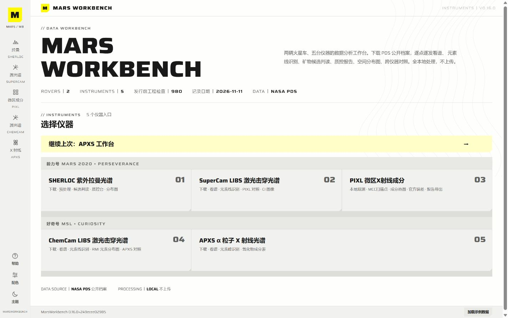
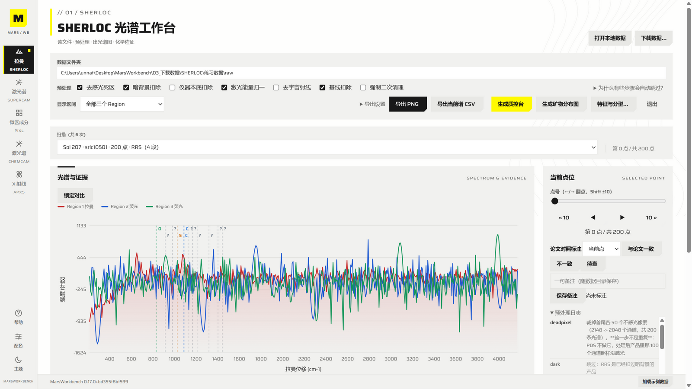
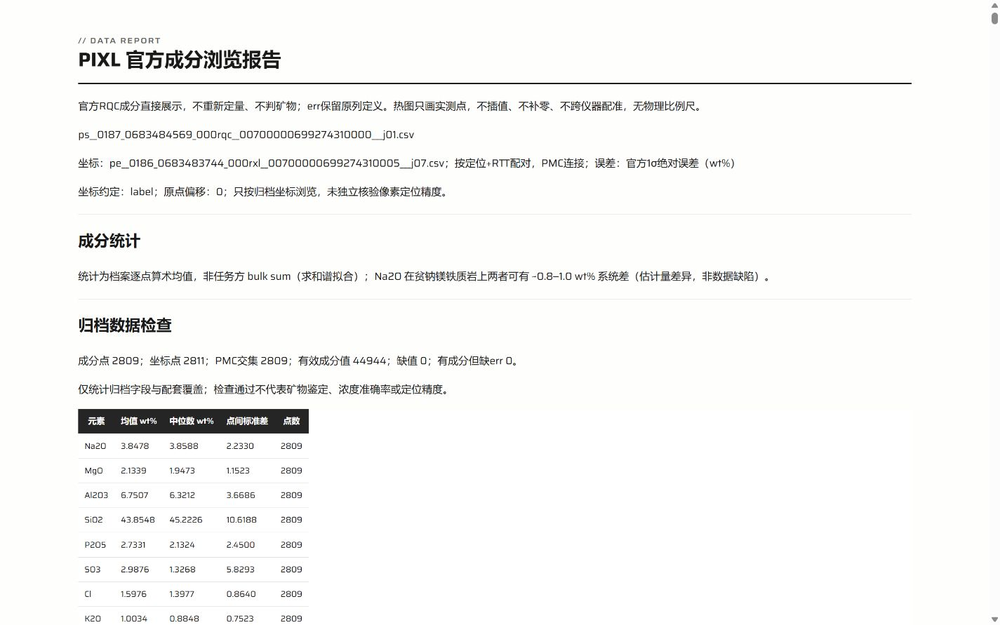

# MarsWorkbench 操作手册

适用版本：0.17.0 / Windows本地预发行。

## 文件夹与启动入口

- “01_核心处理代码”：按SHERLOC、SuperCam、ChemCam、APXS、PIXL划分；共享模块和验证代码单独列出。
- “02_图形界面代码”：启动器、工作台、网页样式、HTTP接口、绘图/报告和导出界面。
- “03_下载数据”：五仪器各有“下载、随包示例、工作示例、缓存”等子目录；SHERLOC练习集和E2E数据分别保留。
- “04_使用说明”：只保留本手册、《代码作用手册》及手册插图。
- “05_安装与发布”：依赖锁定、许可证、资源模板及打包构建工具。

双击工程根目录的启动.bat，从源码启动（首次运行自动准备 .venv 虚拟环境并安装依赖，见根目录 README）；新下载的数据写入“03_下载数据”。左侧切换仪器，“主题/配色”共用。

外部个人数据目录不会自动搬动。工程内旧路径在读取配置时映射到新位置；不要把同一数据集的多份副本放在同一观测扫描根目录。原Sherlock未改动。

## 第一次使用

1. 点击“加载示例数据”，选择仪器和保存位置，再复制并打开。
2. 本工程默认副本在“03_下载数据/仪器/工作示例”；随包原件只读留存，已有同名副本覆盖前询问。
3. 自有数据点“打开本地数据”，保留CSV/FITS/TAB、配对XML/LBL及图像原名。
4. 选观测、点位；先用默认预处理，更改开关要在复核记录中注明。
5. PNG、CSV和报告按界面所示位置生成，不改PDS原件。

## 看谱、标注与导出

“打开本地数据”（旧提示中也称“换文件夹”）选择数据根目录，保留 PDS 产品原名和配对 label/XML。按目标、sol 或元素搜索观测，选点、选发，查看曲线及证据。先用默认预处理；若调整除尘、基线等设置，要在复核记录中写清。「PIQUANT 官方定量层」（PIXL 台，PIQUANT 已部署时可用）：PIQUANT（PIXL 官方开源定量软件，github.com/pixlise/piquant，C++/CMake）是第三条对账线——官方基本参数法对同一份 SFS 原始谱算 wt%。本机已本地构建（MSVC/NMake）并部署于数据根缓存（PIXL/缓存/piquant/：可执行文件+PIXL FM 配置/FM 标定 SurfaceOps Rev1 Jul2021+官方测试谱，piquant_path.json 注册路径与 sha256 指纹，Caltech/UW 许可随附）；也可用环境变量 MARSWORKBENCH_PIQUANT 另指位置，未配置时该层显式跳过。FM 标定官方 COMMENT 指定量化 ENB（B 探测器）谱；批量对账用「01_核心处理代码/PIXL/数据准备脚本/02_piquant_quantify.py」（MSA 导出带本扫描自证能量轴，抽样步长可调，逐氧化物偏差写 piquant_vs_rqc.json）。Bellegarde sol0186 实测（281 点零失败）：FeO-T/SiO2/CaO/Al2O3 中位偏差 -1.6/-2.3/-4.0/-4.3%、相关 0.98-0.99；第二扫描 sol0300（334 点零失败）复验泛化：FeO-T -0.7%/Cl -0.2%/SO3 与 Al2O3 -3.9%/CaO -4.9%（相关 0.89-0.997），两扫描独立自证的能量轴仅差 0.3%；Na/Mg/K/Ti 系统性负偏 10-13%（Bellegarde）而在 sol0300 痕量段（RQC 近检出限）相对偏差失真放大——标定代次与探测器口径差异、含量区间不同，均如实入档非单方错误；FM 标定不覆盖 P2O5/MnO/Cr2O3/Sr（无 ECF 条目）如实排除。工作台 PIXL 台 SFS 面板提供「运行本扫描对账」批量入口（后台任务，步长 10，可取消；默认扫描写主结果文件，其它扫描写独立文件不覆盖主对账）。PIQUANT 输出代表「官方算法复现」，与自研峰面积层、官方 RQC 三方口径分开记录。
「APXS 峰拟合层」（APXS 台，随冻结靶数据可用）：从 rsp 能谱独立拟合元素 Kα 高斯峰（线性背景、Pu 子体参考线不计元素），输出峰高/净面积+泊松误差+检出判定，与官方 rwp 氧化物表做元素序与比值级对账（rocknest3_rp 首靶：Fe/Ca 面积比 6.69 vs 官方元素比 4.25，同量级区间）；峰位自证覆盖全部 14 元素（argmax vs 理论 Kα ≤0.06 keV）。峰面积是原始信号量不是浓度；基本参数定量不在此层。跨靶半定量比值层：绝对面积被跨靶几何/接触距离因子主导（25 靶绝对标定斜率≈0），改用 Si 内标比值后 Ca/Fe/K/Mg 跨靶 log-log 相关 0.886-0.976（Ca 留出中位相对误差 2.5%）；幂律双参标定与验证见「APXS/数据准备脚本/02_ratio_calibration.py」（输出 apxs_ratio_calib.json；比值预测是元素/SiO2 半定量信号，不是绝对浓度）。
「SFS 原始谱层」（PIXL 台，数据准备就绪后可用）：从 PDS data_raw_spectroscopy 读逐 PMC 的 4096 通道原始 XRF 计数（ENA/ENB 双探测器），能量轴由数据多点自证（v4：Si/S/Cl/K/Ca/Ti/Mn/Fe 十线系支持评分；实测逐 PMC 相关 Ca 0.990、Fe 0.978），输出逐元素 Kα 窗净峰面积+泊松误差+检出判定（A/B 探测器择低，与已发表口径一致）及全元素两两 log-log 比值矩阵（66 对，Top：Si/Fe 0.994）。峰面积是「与官方成分独立同源的原始信号量」，不是浓度——跨扫描绝对定量需地形/衍射/死时间修正（PIQUANT 层职责）；要对自己下载的新扫描跑定量，用「01_核心处理代码/PIXL/数据准备脚本/01_sfs_pipeline.py」（自动写能量轴/逐 PMC 对账/比值矩阵三份缓存）。
「PLS 成分（独立标定）」面板（ChemCam 台，模型在位时自动出现）：对本观测的全部主动 CCS 点分别跑与画图同构的预处理后**合成一条观测平均谱**，再用 6 个在轨标定靶训练的 PLS1（纯 numpy NIPALS）预测主氧化物——输出是**观测级成分（非逐点表）**，精度以留一靶交叉验证 RMSE 随行标注（ChemCam：TiO2/MgO/Na2O 达 Wiens 2012 区间、K2O 优于区间、FeOT 经 Fe2O3 当量近似处区间内，5/8）。这是独立复现参考——训练集只有 6 个在轨靶，SiO2 等氧化物精度弱于官方（Clegg 2017 含 408 地面标样），官方 MOC 成分仍是定量引用口径；预测不回写官方产品。训练与再训练见《代码作用手册》ChemCam 数据准备脚本 03（--fit-model）。
「仪器本底扣除」（默认关）按收纳臂暗天空本底谱做缩放相减（Jakubek 2024 口径，光学件在 490/800/1055/1190 cm-1 的固定本底拉曼）：需先用 SHERLOC 数据准备脚本 04/05 下载收纳臂扫描并生成本底谱文件；缩放 M 只按 800 cm-1 主带窗估计（橄榄石识别峰 815-865 的直接邻居）；本底谱覆盖内全波段按形状缩放相减（官方做法），覆盖外通道不动。它是判读对照工具，不是定量步骤。锁定对比固定一条参考谱，缩放独立于锁定；被动谱自动按波长轴展示，不套用 LIBS 元素判定。
「原始帧逐步预处理」（从 data_raw 原始件起步的路线）：只有 ERA/ERB 等原始件、没有已扣背景 RRS 的文件夹，扫描列表会出现带「ERA · 原始帧」标记的条目——选中后用预处理面板从暗背景扣除开始逐步处理（去感光死区→暗背景扣除 ERA−ERB→仪器本底→激光能量归一→去宇宙射线→基线，每步可开关、有日志）；波长轴借用同 sol 官方 RRS 的波长校正表（对原始通道是近似）。无同序列同 expID 暗帧的 ERA 段不出现该条目（暗帧扣除无法进行）。要批量导出扣暗后的 CSV，用 SHERLOC 数据准备脚本 07（07_raw_dark_subtract.py --dir 文件夹，输出「自扣暗_输出」子文件夹并自动并入扫描列表）。共同边界：未做宇宙射线/增益合并之外的官方全部步骤——绝对强度与官方 RRS 不可比，判读看峰位与相对形态。

PageUp/PageDown 翻观测，Home/End 到首末点，数字键可跳点号；输入框中这些键不抢占。逐点“论文对照”可记一致、不一致或待查及备注，存于数据目录 `_notes`，不会改变自动分类。PNG、当前处理谱 CSV 和批量导出存于数据目录的导出位置；报告在 `_qc`。

## 各仪器工作流

| 仪器 | 常用步骤 | 读数边界 |
|---|---|---|
| SHERLOC | 选观测/点→拉曼或荧光→候选证据/拟合→PNG、质控和分布图 | 自动分类及谱库分数是待复核候选 |
| ChemCam | LIBS 看谱/逐发证据或 CL1/CL9 被动谱→RMI 浏览→元素图→**PLS 成分面板**→质控 | 官方元素提示不提供浓度；自研 PLS 是独立估计（RMSE 随行标注）|
| SuperCam | LIBS 或 CP2/CP3 被动谱→官方成分→**PLS 成分面板**→CI/WATSON 浏览→质控 | 官方模型值是归档输出（引用口径）；自研 PLS 口径分开 |
| APXS | 选谱→能谱/配对氧化物表→**峰拟合层+Si 内标比值层**→质控/跨仪器对照 | 比值层适用域=标定时代（sol 629+）内靶；时代外因探测器退化失效（负结果入档）|

## 图像与地图

SHERLOC 随包 ACI 支持灰度地图；WATSON 真彩上色和 PIXL 配准需要全功能版、配套数据及可用网络/缓存。缺失时按提示补数据或换版，不猜配准。

ChemCam 选观测后，在“RMI 图像”面板生成元素分布图；每帧输出 `_maps/map_…png` 与配套 `_points.csv`、`_points.json`。软件用逐点相机模型共帧投影，橙圈表示几何投影；没有比例尺和地面误差证书。缺 label/模型/底图时明确失败。首次需要 EDR 下载，随包 sol01000 已有对应缓存可离线演示。先生成图再生成质控报告，索引地图卡和观测节会链接已有图；须一起保留 `_maps` 目录。

SuperCam 面板按需加载 CI/WATSON 清单与帧，首张 CI 约 25 MB；本地缓存后可重看。滚轮缩放、双击还原；图像取波段 0 作 1–99%灰度拉伸，不改原件。sol187 可取 Bellegarde CI，WATSON 历史清单该 sol 无帧，可明确切到邻日。**同 sol、同停车位置或时间接近均不证明共靶**；不叠加、不投影、不做光斑判定。

## 帮助、诊断与文件保存

左侧“帮助”有四节离线说明，关于中可看许可、来源、健康检查和发行可信度记录。健康检查列必需/可选组件、可写状态、缓存、端口和 PDS 连接（最多约 10 秒）；离线是警告，必需环境缺失是错误。可复制诊断文本求助，分享前检查本地路径及个人备注。

设置/日志在 `%LOCALAPPDATA%/MarsWorkbench`；程序目录只读也可运行。旧相邻设置首次复制迁移，原件不删；旧 PIXL/WATSON 缓存仍在 `~/.sherloc_cache`。portable.flag 切换到程序同层 userdata，该目录必须可写。标注、图表与报告随数据，移动时一起带走；可再生缓存与数据本体分开保存。

GitHub 仓库已发布：[zhendenanbeng/MarsWorkbench](https://github.com/zhendenanbeng/MarsWorkbench)（main 分支，标签 v0.17.0）；仍无在线自动更新。冻结记录来自发行前验证，不表示当前电脑已重跑；检查通过不等于矿物鉴定准确率。开发与检查入口见《代码作用手册》。

## 科学口径

**快速浏览≠定量，检出候选≠矿物鉴定，工程检查通过≠准确率验证。** 目前没有独立盲标矿物真值可支持宣称真实矿物准确率、假阳性率或假阴性率。

LIBS 需独立谱线支持；逐发比例以当前除尘/预处理后保留发为分母，发间独立性未被证明。SNR 和 FWHM 是局部统计；† 表示截断宽度下界。它们不等于浓度或置信概率。SuperCam 归档成分与 APXS 氧化物为团队官方输出，跨点均值仅为描述统计，不缩小官方模型误差。

SHERLOC 规则分类、拟合、谱库代理 AUC、探索分型用来定位待复核候选；代理 AUC 对比规则标签，缺少独立真值。金标准是软件行为护栏，已知论文差异、R3 缺口和 sol349 假阳性仍留档。人工标注不回灌默认分类。CP2 吸收特征非唯一，不作矿物确认。跨仪器同址比较也不证明共靶。

**自研定量层的适用边界（负结果同样入档）**：PIXL 能量轴 v4 已双扫描验证（自证轴差 0.3%），但扫描内标定 k 仅本扫描有效——跨扫描绝对定量需地形/衍射/死时间修正（PIQUANT 层）；APXS Si 内标比值层适用域=标定时代（25 靶 sol 629-4327）内的靶——对时代外靶（rocknest3_rp sol 102）冻结幂律预测偏差 -85%~+60%（探测器随任务时间退化），不可用；LIBS PLS 训练集仅 6/17 个在轨靶，精度弱于官方是数据上限不是方法缺陷。所有冻结数字可在发行护栏/数据审计/文献对账三套检查中独立复现。

论文应引用 PDS 实际产品/版本、仪器方法、工具版本与预处理，并附可信度边界。历史研究报告已移除；测试需要的既有数值保存为机器可读基准，原始数据和回归检查继续保留。代码位置与验证入口见《代码作用手册》。

## PIXL 独立浏览台

启动器→PIXL，在页脚点“加载示例数据”，选择保存位置后复制，即可离线体验；也可打开包含RQC、RXL及其XML、所引用MCC图像的本地目录。成分按RQC处理sol列出，可能不同于坐标/图像采集sol。配对先限制同定位与RTT，再按PMC连接；有多个RXL候选时须选择，不自动拼接。仅有成分表仍可看表、导出CSV与报告。

选MCC帧，切“扫描点”或16项官方成分指标（含氧化物及Cl/Br）。点击图上点位，或输入PMC，查看归档wt%及err。XML明确给出时标记为1σ绝对误差；缺XML不冒称σ定义。0是归档原值，缺值显示—，不把0当确认检出。热图按当前图内有效值范围着色，不插值、不重算含量、不做物相鉴定；不需要OpenCV。

导出按钮生成全部PMC成分CSV（UTF-8-BOM）、当前指标PNG、坐标CSV、来源SHA和HTML报告，存入数据目录的 `_pixl_exports` 唯一子目录。CSV保留原数值精度；缺MCC不生成虚构热图，表和报告仍可用。相对链接允许整个输出目录搬走。

官方RDR SIS第5.2.1节及XML定义 i=line/y、j=sample/x。本台使用此定义；不套用旧跨仪器辅助模块的相反轴约定，也不修改其历史产物。本期不声称地面定位精度、物理比例尺或跨仪器共靶。原始XRF能谱浏览尚未实现。

### PIXL 数据下载

点“下载数据…”→必要时“刷新列表”→按成分处理Sol选择扫描（Ctrl/Shift可多选）→选择保存目录和是否包含MCC→“开始下载”。清单显示采集坐标sol，可能与成分处理sol不同。清单只列当前已验证RQC格式，不代表PIXL全部产品；RCC及原始XRF不在此次范围。

从本工程启动时，默认保存位置为“03_下载数据/PIXL/下载”，也可选择其他可写位置。每个扫描分目录保存CSV、XML及其官方引用的MCC；文件原字节保留，下载记录含URL、LID、公开MD5（若提供）、本地SHA-256与时间。完成后点“打开已下载数据”直接进入浏览台；MCC 帧按 RXL 引用动态列出（示例引用 4 帧，本地缺帧不虚构）。

支持取消和按已完成文件继续：取消等待当前网络读取返回（超时约30秒），清理当前临时体，保留已完成文件；重试会核验并复用完成文件，不是按字节HTTP Range续传。同名但无法核验的本地文件不覆盖，请保留原件并改选空目录。部分图像失败时保留成分表、显示具体失败列表，可再次下载。清单刷新失败如有缓存会注明缓存来源与时间，首次离线则不能列远程产品，本地浏览/示例仍可用。

下载依据PDS API的真实文件引用，不由产品名猜归档目录；支持官方API的NASA HTTPS跳转主机。MCC关联严格来自RXL XML与PMC，包含pcw、pcd及lu压缩标识，不按近时间猜图。

## 各工作台统一的操作方式

1. 标题右侧“打开本地数据”打开内嵌目录选择器，可粘贴路径、用当前目录或选最近五次记录；“下载数据…”展开同位置的下载卡。页脚示例加载统一使用仪器选择、保存目录和覆盖询问。
2. 上方筛选和选择观测，右侧翻点，再用滑块、左右按钮翻点，Shift±10、Home/End首末点、PageUp/PageDown翻观测。PIXL数字键按真实PMC跳转，允许四位及更长PMC；稀疏点号不补虚构点，滑块按实际点序移动。输入框/选择器/目录与下载面板里不抢快捷键。
3. “导出PNG”只导出当前MCC帧与当前指标的原分辨率图；“导出当前点CSV”导出当前PMC，导出设置可改为当前观测全部点CSV、修改PNG/CSV目录。各操作分开，不再默认捆绑所有产物；结果可直接打开，并有“打开输出目录”。
4. “生成质控报告”在后台处理当前目录全部观测，列表筛选不缩小报告范围；可取消并保留已完成部分。PIXL报告统计归档字段、缺值、误差及PMC配套覆盖，附逐点表与来源SHA，不能当作矿物鉴定、浓度或定位准确率证书。生成后按其他台方式打开报告，也保留链接；在源码/自动验收的headless模式不会弹原生窗口。
5. 下载卡支持多Sol和多扫描、看图够用的/全选/全不选、保存目录、进度、取消、打开目录和打开数据。默认不把父目录下“下载”中的副本混入当前观测；下载完成后打开其目录单独浏览。
6. 左侧导航直接切换五台仪器，顶部M标记回到启动器。侧栏“主题”快速切换深浅色，“配色”可选亮黄/柔黄与跟随系统，偏好在各台同步。

PIXL继续保留MCC帧、成分指标、坐标候选与真实PMC，展示的是官方成分原值，不套用光谱预处理、发数或元素线判定。切帧/换成分指标保持当前PMC与缩放，换观测则重置到新观测的有效点。

## PIXL当前帧成分表与视图

MCC下方的“当前帧成分数据”只列本帧图内且有RQC记录的点。点击一行会选择对应实际PMC，图像标记和右侧原值/误差同步；所选指标列用黄色标明。翻页不缩小报告或CSV的原有范围。缺图时不虚构图内点，仍可用右侧PMC浏览已有成分。

“扫描区”聚焦本帧真实坐标范围，“全图”恢复适应完整图像；加减/滚轮继续缩放。显示缩放不改变归档坐标、数值或PNG的原始分辨率。切帧继续保留实际PMC与现有缩放，默认成分指标为可用的SiO2，缺该指标则使用扫描点。

## 故障排查

- 无观测：检查仪器、类型、配对标签及根目录；RQC与RXL的Sol可以不同。
- 缺图：补对应MCC/ACI；成分表仍可读，不生成虚构底图。
- 下载失败：查看明确错误，可取消重试；已完成文件按校验复用。
- 同名未核验文件：保留原件并换空目录，不强行覆盖。
- 不可写：改选自己的可写目录，不在软件资源目录分析。
- 可选库缺失：标准版保留核心功能，对应可选流程使用全功能版。
- 开「仪器本底扣除」提示找不到本底谱：先运行 SHERLOC 数据准备脚本 04（下载收纳臂扫描，需联网）与 05（生成本底谱），再重新勾选；离线时该步保持跳过，不影响其余流程。
- 端口冲突：启动器自动选端口，通过侧栏导航，不手工记旧端口。
- “帮助→关于/健康检查”可查组件、日志和冻结记录；分享诊断前检查个人路径与备注。

## 数据保护与公开发布

原件与工作副本分开保存。数值基准和数据校验记录随代码保留。重构与exe打包不构成算法保密措施；源码与开发用wheel包含实现，公开发布前需另定授权和保护策略。第三方许可证随安装文件保留。

## 开发与检查入口

见[代码作用手册](代码作用手册.md)。数据无需复制进程序目录。

## 操作示意

