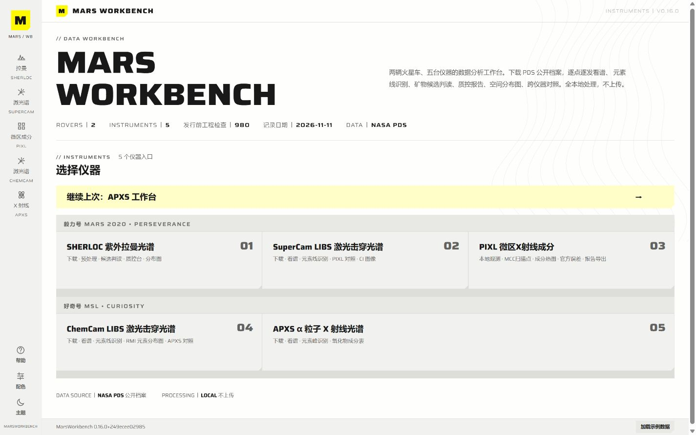
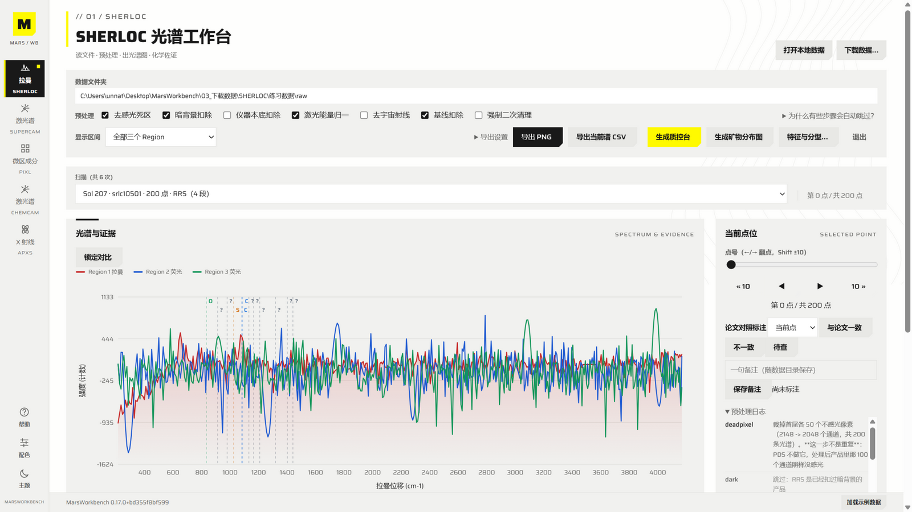
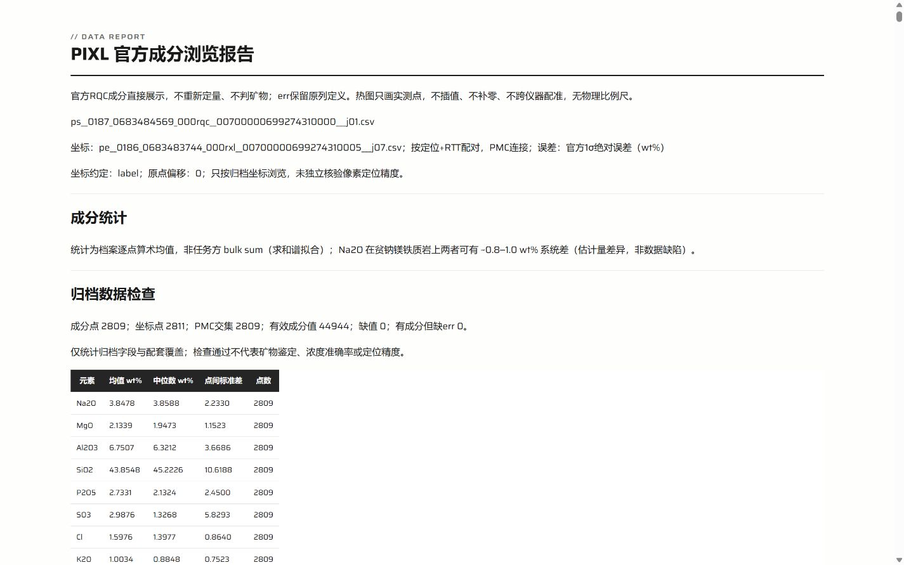

# MarsWorkbench · 火星多仪器光谱辅助判读工作台

**版本 0.17.0** · Windows 本地运行 · 纯离线可用 · MIT 开源

MarsWorkbench 是一个浏览、**自研定量**与文献对账检查 **NASA 火星车 PDS 公开光谱数据** 的本地工作台，覆盖五台仪器——每台都包含「从谱级原始数据自算科学数字」的自主处理层，官方产品仅作对账基准：

| 仪器 | 火星车 | 你能做什么 |
|---|---|---|
| **SHERLOC** | 毅力号 Perseverance | 深紫外拉曼/荧光谱浏览、预处理、**仪器本底扣除**（收纳臂暗天空法）、候选矿物峰组、与 Sun 2023 已发表结论逐靶对账（14 类目）、质控报告 |
| **SuperCam** | 毅力号 Perseverance | LIBS 谱线证据、被动光谱、**自研 PLS 成分**（留一靶 CV 冻结；官方 MOC 区间判定 0/7 如实入册，TiO2 锚点待转录）、官方 MOC 对账并排、CI/WATSON 图像浏览 |
| **ChemCam** | 好奇号 Curiosity | LIBS 逐发证据、CL1/CL9 被动谱、RMI 图像与元素分布图、**自研 PLS 成分面板**（元素线窗/全谱混合策略，8 氧化物） |
| **APXS** | 好奇号 Curiosity | 能谱浏览与官方氧化物配对表、**自研峰拟合层（14 元素）+ Si 内标比值层**（Ca 留出误差 2.5%）、跨仪器对照 |
| **PIXL** | 毅力号 Perseverance | MCC 图像 + 官方成分逐点浏览、**SFS 原始谱六层定量链**（v4 多点线系能量自证→逐 PMC 峰面积→66 对比值矩阵→扫描内半定量标定→文献盐校正对账→PIQUANT 官方开源定量层：FM 标定 × RQC 逐 PMC 对账，四大主量中位偏差 ≤4.3%）、PDS 数据下载与独立管线脚本 |

所有计算在你自己的电脑上完成，**数据不上传、分析不联网**（仅“下载数据”功能按需访问 NASA PDS）。



---

## 🚀 三步上手（Windows）

### 第 1 步：安装 Python

安装 [Python 3.12](https://www.python.org/downloads/)（3.10 – 3.13 均可），安装时**务必勾选 “Add python.exe to PATH”**。
已装过的可跳过；本步骤只需要做一次。

### 第 2 步：安装依赖

双击本目录下的 **`安装依赖.bat`** —— 自动创建虚拟环境并安装 numpy + pillow（约 40 MB）。

想要全部可选功能（WATSON 真彩上色等图像流程）时，改用完整版：

```bat
安装依赖.bat full
```

### 第 3 步：启动

双击 **`启动.bat`**。首次运行会自动完成环境准备，然后弹出 MarsWorkbench 启动器窗口。

## 👀 第一次使用（2 分钟看到第一张谱）

1. 在启动器左侧选择任一仪器，例如 **SHERLOC**；
2. 点击页脚 **“加载示例数据”** → 选一个保存位置 → **复制并打开**（示例是 PDS 公开产品，随包自带 SHA-256 校验，完全离线可用）；
3. 选择观测、翻看点位，查看谱线、预处理开关与质控指标；
4. 需要**处理自己的数据**时，点标题右侧 **“打开本地数据”** 选择你的 PDS 产品目录（保留 CSV/FITS/TAB 原名与配对 XML/LBL 即可）。



PIXL 台同理：启动器 → PIXL → 页脚 “加载示例数据”，即可离线体验 MCC 图像 + 逐点成分。



## ⌨️ 常用操作

| 操作 | 方式 |
|---|---|
| 翻观测 | `PageUp` / `PageDown` |
| 翻点位 | 右侧滑块/箭头；`Shift`±10；`Home`/`End` 首末点；数字键跳点号 |
| 换数据目录 | 标题右侧 “打开本地数据” |
| 下载 PDS 数据 | “下载数据…”（按成分处理 Sol 选择；已完成文件按校验复用——文件级续跑，非字节级 HTTP Range 续传） |
| 导出 | 导出 PNG / 当前点 CSV / 生成质控报告（各操作独立） |
| 深浅色主题 | 左侧栏 “主题”；“配色”可选亮黄/柔黄 |

## 📖 深入阅读

完整操作细节、各仪器工作流与科学口径边界，见随包手册（程序内 “帮助” 也内置同样的离线说明）：

- [04_使用说明/操作手册.md](04_使用说明/操作手册.md) —— 怎么用
- [04_使用说明/代码作用手册.md](04_使用说明/代码作用手册.md) —— 每个文件是什么、开发与自检入口

## 📁 目录结构

```
MarsWorkbench/
├── 启动.bat / 安装依赖.bat    ← 双击入口（bootstrap.py 负责首次环境准备）
├── 01_核心处理代码/           五仪器后端 + 共享模块 + 验证护栏
├── 02_图形界面代码/           启动器、工作台页面、HTTP 服务、导出
├── 03_下载数据/               随包示例（离线体验用）；你的下载/工作副本也在各仪器目录下
├── 04_使用说明/               两本手册 + 截图
├── 05_安装与发布/             依赖锁、许可证、资源模板、构建工具
├── setup.py / pyproject.toml  pip 安装支持（mars-workbench 命令）
└── .project-layout.json       目录映射（程序靠它定位各模块，请保持目录名不变）
```

## 🧪 自检（可选）

源码自带离线护栏。发行自包含检查（不依赖开发数据集）：

```bat
.venv\Scripts\python.exe 01_核心处理代码\验证\verify\run_all.py --dist
```

当前 **19 条护栏、436 项断言**，涵盖读数、预处理（含「仪器本底扣除」开关契约）、报告导出、PIXL 浏览/下载、LIBS/PIXL/APXS 自研定量层、主题与目录分离。另有开发侧检查（需研究数据集，不随本仓库分发）：**独立数据审计 26 项**（训练谱 SHA、CV 真留一复算、逐 PMC 峰面积精确复现、台账指纹、跨扫描一致性）与**文献定量对账 24 项**（Schmidt 2025 盐校正复算、比值矩阵、扫描内标定、APXS 峰位自证）。

> 检查通过代表软件行为与冻结基准一致，**不等于**矿物鉴定准确率（见下节）。
> **五仪器自主处理能力（全部从谱级原始数据自算，官方表仅作对账基准）**：
> ChemCam/SuperCam 自研 PLS 成分（留一靶 CV 冻结；ChemCam 5/8 氧化物达 Wiens 2012 区间或更优——TiO2 0.190/MgO/Na2O 达区间、K2O 优于区间、FeOT 经 Fe2O3 当量近似处区间内；SuperCam 区间判定 0/7 如实入册、TiO2 官方 RMSEP 待转录）；PIXL SFS 谱层——能量轴 v4 多点线系自证（**发现并修正旧轴 13% 增益偏差**，逐 PMC 相关 Ca 0.990 / Fe 0.978，双扫描验证）+ 逐 PMC 峰面积（A/B 探测器择低，与已发表口径一致）+ **66 对元素比值矩阵** + 扫描内半定量标定（Ca 中位残差 4.8%）+ Schmidt 2025 盐校正对账（8/10 氧化物落 ±σ）+ **PIQUANT 官方开源定量层**（github.com/pixlise/piquant 本地构建，ENB × 官方 FM 标定逐 PMC wt%；双扫描对账：Bellegarde 281 点 FeO-T/SiO2/CaO/Al2O3 中位偏差 -1.6/-2.3/-4.0/-4.3%，第二扫描 334 点复验泛化 FeO-T -0.7%，两扫描独立自证能量轴仅差 0.3%，痕量段失真如实入档）；APXS 峰拟合（14 元素）+ **Si 内标比值层**（Ca 跨靶 0.976，留出中位误差 2.5%）；SHERLOC 分类已通过 Sun 2023 / Corpolongo 2023 逐靶对账（14 类目 7 复现，其中 3 类经 silicate 粗类映射命中）。每层的量化适用边界见操作手册对应段（负结果同样入档）。
> 想参与提升判读精度？看 `01_核心处理代码/验证/verify/fixtures/历史数值基准/published_targets.json`（已发表靶点台账）与 `01_核心处理代码/研究脚本/` 下的对比实验——欢迎按台账哲学补充已发表靶点。

## 🔬 科学口径（使用前必读）

- **快速浏览 ≠ 定量，检出候选 ≠ 矿物鉴定，工程自检通过 ≠ 准确率验证。**
- 官方元素提示是分类辅助；本工具的**自研浓度层**（LIBS PLS、PIXL 扫描内标定、APXS 比值层）是独立估计，精度与适用域随行标注，不替代官方产品。
- SHERLOC 自动分类是待复核候选，金标准差异台账中已知缺口与历史假阳性均有留档。
- SuperCam 归档成分与 APXS 氧化物是任务团队官方输出，仍是定量引用口径；自研层与官方产品并排展示、口径分开。
- 跨仪器同址比较不证明共靶；图像叠加仅作浏览辅助。
- 论文引用请引用 PDS 实际产品/版本与预处理设置，并附可信度边界；详见操作手册《科学口径》一节。

## 🧰 从源码运行（进阶）

```bat
py -3.12 -m venv .venv
.venv\Scripts\pip install numpy pillow
.venv\Scripts\python 02_图形界面代码\launch.py
```

也可 `pip install .` 后使用 `mars-workbench` 命令。命令行参数：`launch.py [--port 8790] [--console-port 8766] [--browser] [--no-window]`。
打包 Windows 免 Python 发行版的构建工具在 `05_安装与发布/构建工具/`。

设置、日志与可再生缓存位于 `%LOCALAPPDATA%\MarsWorkbench`；程序目录保持只读即可正常运行。

## ❓ 常见问题

| 现象 | 处理 |
|---|---|
| 双击启动无反应 | 先运行 `安装依赖.bat`；确认 Python 安装时勾选了 Add to PATH |
| 无观测列表 | 检查仪器/类型/根目录；示例请先 “加载示例数据” |
| 缺图像 | 补对应 MCC/ACI 产品；成分表仍可读 |
| 下载失败 | 看明确错误提示，可取消重试；已完成文件按校验复用 |
| 端口冲突 | 启动器自动换端口，用侧栏导航切换仪器 |
| 其他 | 见《操作手册》故障排查一节；程序内 “帮助 → 健康检查” 可复制诊断信息 |

## 📄 许可与数据来源

- 代码：[MIT License](LICENSE)；界面字体 Saira 按 [SIL OFL](05_安装与发布/资源模板/licenses/Saira-OFL.txt) 自托管，完全离线。
- 随包示例数据来自 [NASA Planetary Data System](https://pds.nasa.gov/) 公开归档（SHERLOC / SuperCam / ChemCam / APXS / PIXL），**不适用 MIT 授权**，引用与致谢见 [DATA_SOURCES.md](05_安装与发布/许可证/DATA_SOURCES.md)；NASA 标识不代表对本工具的认可。
- 第三方组件声明见 [THIRD_PARTY_NOTICES.md](05_安装与发布/许可证/THIRD_PARTY_NOTICES.md)。

## ⚠️ 状态声明

本项目为 0.17.0 本地预发行：无在线更新；未经独立盲标验证的矿物准确率数据，请勿引用本工具宣称任何鉴定准确率、假阳性率或假阴性率。欢迎 issue 反馈问题。
